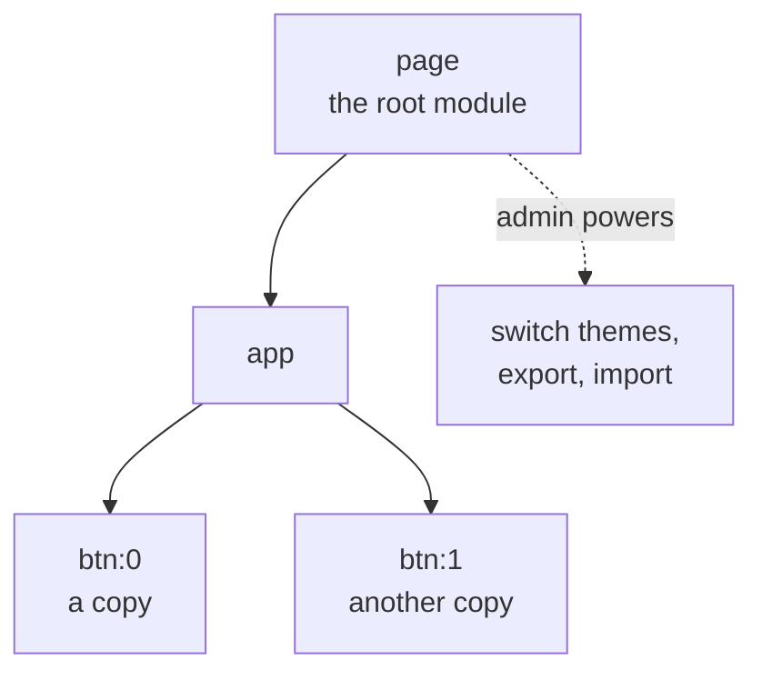

# STATE.js, net.js and DOCS.js in simple words

What the frontend side of datashell can do today, checked against the code ([playproject-io/datashell @ `7976541`](https://github.com/playproject-io/datashell/tree/7976541ff36f2b7b1c237873aae4104d8f079d1e); DOCS.js is in [ddroid/ui-components @ `e2879e9`](https://github.com/ddroid/ui-components/tree/e2879e95dbb5ba8a29851422a85c8d37ad1f881b)).

---

## The big picture

- **An app is a tree of modules.** A module can be used more than once, and each copy is an **instance** (`page>app>btn:0`).
- **The tree has tricky cases, not all handled yet:** the same module in many places (same or different versions), parts that don't use `sdb` at all, a module used many times inside one module, and a whole app or pod inside an app.
- **Each module says what it starts with** (its **fallback**). **Any module above it** (not only its parent) can **change what it starts with** (an **override**).
- **Each module and instance gets an `sdb`** with a **drive**: it works like a disk of its own, and it's told when files change.
- **The root module** (usually `page`) has extra **admin** powers: switch themes, add, export and import data.
  - **The goal:** see the whole app's state (every module, also apps and pods inside it), pick one part like in the browser's dev tools, and run admin commands on it. What STATE.js needs to change comes from this goal.
- **Everything is saved in the browser** (`localStorage`) today. Later it will all be saved in the p2p vault.
- **Parts talk with messages** through **net.js**. Later it needs to support every way the p2p parts can talk.
- **DOCS.js** lets a part list what it can do (its API), with help texts shown in the devkit.

---

## STATE.js

| You want to… | You call |
|---|---|
| say "I am a module" | `const statedb = STATE(__filename)` |
| (root only) open the database | `statedb.admin()` |
| give your defaults, get your tools | `const { sdb, get } = statedb(fallback_module)` |
| give a new instance its own `sdb` (its own drive, separate from the module's) | `const { id, sdb } = await get(sid)` |
| be told when your files change | `await sdb.watch(onbatch)` |
| read / write / list your files | `sdb.drive.get(path)` · `put(path, content)` · `list(folder)` · `has(path)` |
| peek into a child's files (read only) | `sdb.get(sid)` |
| (root only) switch, add, export, import | `sdb.admin.swtch()` · `register()` · `export_db()` · `import_db()` … |

The drive has only these 4 methods (no delete yet). That's on purpose: more methods come later, like a hyperdrive or autodisk, once the nested `sdb`, the devkit and overrides all work.

## net.js

- **Each part gets `net(id)` → `{ io, _ }`.** A parent invites a child (`io.invite`), the child accepts (`io.accept`), then each sends with `_[name](type, data, refs)`.
- **A message looks like** `{ head: [by, to, mid], refs, type, data, meta }`:
  - `head`: who sent it (`by`), who gets it (`to`), and a message number (`mid`). Together they never repeat, in any message, anywhere.
  - `refs`: points to other messages' heads. The main one is `refs.cause`, the message that caused this one (`refs: { cause: msg.head }`).
  - `type` is a text. `data` can be anything, depending on the `type`.
  - `meta` has at least `time` (when it was made) and `stack` (where in the code it was made).
- **`io.js`** (which STATE also gives out) is old and will be replaced by net.js.
- **net.js will still change.** `invite` / `accept` will likely stay, but later it also needs to send streams of data and more p2p kinds of messages, when we join it with the p2p vault.
- **Ahmad's newer net.js** adds one check: two connections can't have the same name (it throws). Worth adding.
- **The news app's own copy (`net_helper`) sends `(type, refs, data)`**, and datashell's net.js sends `(type, data, refs)`. The plan: switch everything to `(type, refs, data)`.

## DOCS.js

- **A component lists its actions: that's its official API.** Anything a user can do with mouse or keyboard can also be done in code.
- **Each action can have a help text.** The devkit (the quick editor) shows it, and in help mode a click shows the help text instead of doing the action.
- **It doesn't use STATE yet** (no `sdb`, `drive` or `io`), and it isn't part of datashell yet. Later it becomes one more part of what `get(sid)` gives, next to `sdb`.
- It's still work in progress.

`sdb` may one day be renamed to `node` (`node.disk`, …). For now it stays `sdb`.

---

## Where Ahmad's summary is out of date

- It says STATE.js has 1,244 lines; it now has 1,424. Its line numbers are off.
- It names functions that no longer exist (`check_version`, `validate_and_preprocess`), and misses some admin methods (`import_root`, `export_root`, `get_dataset`, …).
- It doesn't say `sdb.get(sid)` is read only, or that reloading the page clears the saved data when running through the shim.

---

## Possible bugs (found by reading the code)

Each one gets a test first. Some may be old code that nothing uses anymore.

1. **3 admin methods crash:** `unregister`, `import_db` and `import_root` call functions they can't reach ([L1146](https://github.com/playproject-io/datashell/blob/7976541ff36f2b7b1c237873aae4104d8f079d1e/lib/node_modules/STATE.js#L1146), [L1163](https://github.com/playproject-io/datashell/blob/7976541ff36f2b7b1c237873aae4104d8f079d1e/lib/node_modules/STATE.js#L1163), [L1169](https://github.com/playproject-io/datashell/blob/7976541ff36f2b7b1c237873aae4104d8f079d1e/lib/node_modules/STATE.js#L1169)). Maybe old code.
2. **A typo (`${subi,d}`) turns an error message into a crash** ([L1279](https://github.com/playproject-io/datashell/blob/7976541ff36f2b7b1c237873aae4104d8f079d1e/lib/node_modules/STATE.js#L1279)). Maybe old code too.
3. **After switching themes, the drive may read one dataset but write another:** `drive.get` looks in `node.inputs` ([L995](https://github.com/playproject-io/datashell/blob/7976541ff36f2b7b1c237873aae4104d8f079d1e/lib/node_modules/STATE.js#L995)), `drive.put` looks in `node.drive` ([L1020](https://github.com/playproject-io/datashell/blob/7976541ff36f2b7b1c237873aae4104d8f079d1e/lib/node_modules/STATE.js#L1020)).
4. **Not a bug:** a new version clears all of `localStorage` ([L780-L783](https://github.com/playproject-io/datashell/blob/7976541ff36f2b7b1c237873aae4104d8f079d1e/lib/node_modules/STATE.js#L780-L783)). That's on purpose, so old data doesn't break the page. Moving old data over comes later.
5. **Leftovers, not a bug:** a `LESEZEICHEN:` label and a `debugger` ([L254](https://github.com/playproject-io/datashell/blob/7976541ff36f2b7b1c237873aae4104d8f079d1e/lib/node_modules/STATE.js#L254), [L260](https://github.com/playproject-io/datashell/blob/7976541ff36f2b7b1c237873aae4104d8f079d1e/lib/node_modules/STATE.js#L260)). They mark an unfinished fix for example 2.
6. **net.js:** a message sent through a middle part may fail. The middle part passes it on ([L37](https://github.com/playproject-io/datashell/blob/7976541ff36f2b7b1c237873aae4104d8f079d1e/lib/node_modules/net.js#L37)), but the last part only accepts senders it's directly connected to ([L38](https://github.com/playproject-io/datashell/blob/7976541ff36f2b7b1c237873aae4104d8f079d1e/lib/node_modules/net.js#L38)).
7. **DOCS.js:** it throws when a component has no actions ([get_actions](https://github.com/ddroid/ui-components/blob/e2879e95dbb5ba8a29851422a85c8d37ad1f881b/src/node_modules/DOCS/index.js#L45)). Serapath: a bug, it should return an empty list `[]`, like `get_toc` does. (waiting on ahmad).

---

## What the vault gives vs. what `sdb` has

**To discuss before it becomes a plan.** Not every vault feature belongs in `sdb`, the part apps use. Some only help STATE.js inside, and some are for other parts: net.js, DOCS.js, or things not built yet (the sys UI, the box UI). Today we only have apps using STATE.js and the admin part (`sdb.admin()`), with no apps or pods inside apps yet.

| The app vault gives | `sdb` today | Missing |
|---|---|---|
| save / read small data (`vault_put` / `vault_get`) | partly: `sdb.drive.put` / `get` | not synced |
| delete (`vault_del`) | ❌ | the drive has no delete |
| watch for changes (`vault_watch`) | partly: `sdb.watch` | only this browser |
| its own storage space (`store`) | ❌ | no p2p storage behind `sdb` |
| data structures (`create_ds_manager` …) | ❌ | — |
| remember the app and its keys (`register_app`, `get_app`) | ❌ | — |
| the app's history (`get_app_audit`) | ❌ | — |
| let a new device write (writer access) | ❌ | — |
| networking (`network`) | partly: net.js | only inside one page |
| docs | ❌ | DOCS isn't part of `sdb` |

**Good news:** `statedb.admin()` already accepts a different database instead of the browser one. That was one reason for it. What the p2p vault really needs will show once we join them.

## Ideas for the first STATE.js pull request

1. Fix the crash bugs and remove the debug leftovers (bugs 1, 2, 5).
2. Add `sdb.drive.del(path)`.
3. Fix the read/write mix-up and only clear STATE's own data (bugs 3, 4).
4. Write down what a custom database must provide, so a vault-backed one can be written next.
5. Then the first p2p step: a database that saves into the vault instead of the browser.

Steps 1–3 fix STATE.js as it is. Steps 4–5 start connecting it to the p2p vault.

---

**Not checked:** nothing was run, everything comes from reading the code. Ahmad's "state-architecture" page (with its verification matrix) is still missing.
